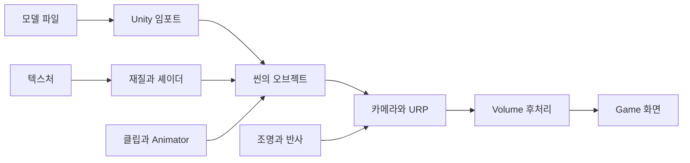

# 프로젝트 지도

> 모르는 단어는 [전문 용어 전체 색인](../../90_용어사전/README.md)에서 영문·한글로 찾습니다. 이 장 맨 아래에는 등장 용어의 바로가기 목록이 있습니다.

## 읽기 전에: 프로그램, 프로젝트, 장면

준비 A~C를 먼저 읽습니다. **프로젝트**는 제작에 필요한 파일과 설정 전체, **씬**은 그 안에서 물체의 배치와 연결을 저장한 한 장면입니다. **에셋**은 프로젝트에 저장한 재사용 자료입니다. 캐릭터 파일을 여러 씬에서 쓰더라도 실제 원본 파일은 하나일 수 있습니다.

아래 지도에서 **렌더링**은 장면을 화면으로 계산하기, **애니메이션**은 시간에 따라 자세 등을 바꾸기, **UI**는 버튼·글자처럼 사람이 조작하고 읽는 화면입니다. **패키지**는 기능을 묶어 설치하는 단위입니다. 다른 기능에 필요한 패키지를 **의존성**이라고 합니다. 설치 여부와 씬 연결 여부를 나누어 보는 이유입니다.

폴더명 앞 `01.`, `02.`는 제작자가 붙인 정리용 이름입니다. Unity가 자동 실행하는 순서를 뜻하지 않습니다. 반면 정확한 `Editor` 같은 폴더명에는 Unity의 특별 규칙이 있습니다. [Editor 도구](../03_Editor도구/README.md)와 [빌드와 배포](../../83_빌드/빌드와배포.md)에서 구분합니다.

## 무엇을 만드는 프로젝트인가

캐릭터를 올려놓는 작은 사진관이라고 생각하면 됩니다. 캐릭터는 피사체, 씬은 촬영장, 카메라는 보는 눈, 조명은 손전등, 재질은 표면의 성질입니다. 후처리는 사진을 찍은 뒤 색을 조절하는 작업과 비슷합니다.

실제 파일은 **VARCO 3D 모델 전시·렌더링·애니메이션 실습 프로젝트**라는 해석을 뒷받침합니다. 플레이어 이동·전투·저장·네트워크 게임 흐름은 현재 작성된 코드에서 확인되지 않았습니다.

## 폴더의 역할

| 경로 | 들어 있는 것 | 공부할 때 하는 일 |
|---|---|---|
| `Assets/VARCO_URP/01.Varco3D` | 로봇·여신상·스튜디오 모델 | 배치할 모델과 클립 찾기 |
| `Assets/VARCO_URP/02.Materials` | 금속·도장·돔 재질 | 표면 비교 |
| `Assets/VARCO_URP/03.Prefabs` | `Lab_Studio_Env.prefab` | 스튜디오 구성 확인 |
| `Assets/VARCO_URP/04.Scenes` | 씬 2개, 베이크 결과 | 수업 시작 |
| `Assets/VARCO_URP/05.Editor` | Scene 뷰 오버레이·생성 버튼 | 작업 도구 이해 |
| `Assets/VARCO_URP/06.Scripts` | 회전·UI·VARCO 변환 코드 | 동작 원리 읽기 |
| `Assets/VARCO_URP/07.Settings` | URP·Volume·Input·VFX·조명 | 화면 설정 추적 |
| `Assets/VARCO_URP/08.Shaders` | Shader Graph·HLSL·반사 코드 | 표면과 특수 효과 이해 |
| `Assets/VARCO3DImports` | Bridge가 받은 Walk USDZ | 원본 가져오기 경로 확인 |
| `Assets/VARCO_Converted` | Walk·Run 변환 결과 | FBX·텍스처·클립·프리팹 비교 |
| `Packages` | 기능 패키지와 Bridge 코드 | 외부 기능 확인 |
| `ProjectSettings` | 프로젝트 전체 설정 | 버전·입력·빌드 씬 확인 |
| `Library`, `Temp`, `Logs` | Unity의 캐시·임시 파일·기록 | 원본 학습 파일로 취급하지 않음 |

## 두 씬을 구분한다

`SampleScene`은 카메라·Directional Light·Global Volume을 갖춘 기본 씬입니다. `Lab_Varco3D_01`은 스튜디오와 모델이 들어 있는 주 실습 씬입니다.

```text
Lab_Varco3D_01
├─ Main Camera                  카메라 + UVC_Reflections
├─ Lab_Studio_Env                프리팹 인스턴스
│  ├─ Lighting
│  │  ├─ Spot Light_MD           여러 Spot Light
│  │  ├─ Volume Profile          씬에서 Lab_Studio 프로필 연결
│  │  ├─ Reflection Probe Main  주변 풍경 반사
│  │  └─ Reflection Point       평면 반사의 기준 위치
│  └─ Canvas                     로고·ProgressBar 등
├─ FloatingDust                 VFX Graph 먼지
├─ Chibi Robot                  Walking.controller 연결
├─ Streetwear Robot_Walk        변환 FBX + Animator, 재확인 시 비활성
├─ Streetwear Robot_Runing      저장 상태에서 비활성
├─ Classical Goddess Statue 계열  저장 상태에서 비활성
└─ Decal Projector, Sphere들     추가 표면 실습 대상
```

위 그림은 공부에 필요한 부분만 뽑은 지도입니다. 구분선 오브젝트·뼈·중첩 모델까지 모두 나열한 Hierarchy 복제본은 아닙니다. 씬에서 프리팹 일부가 제거되거나 값이 바뀐 **Override**도 있습니다.

작성 중 씬 저장이 바뀌어 다시 읽은 상태를 반영했습니다. 학습 실습에서는 현재 켜진 모델을 추측하지 말고 이름과 활성 체크를 확인합니다.

## 화면이 나오는 흐름



문제가 생기면 이 화살표를 거꾸로 따라갑니다. 화면이 하얗다고 무조건 텍스처 문제는 아닙니다. 후처리 노출, 광원, 재질, 실제 연결 파일을 차례로 확인해야 합니다.

## 설치된 것과 사용 중인 것은 다르다

| 항목 | 파일에서 확인한 상태 |
|---|---|
| URP 17.6.0 | 실제 Graphics·Quality 설정에 연결 |
| Input System 1.20.0 | 새 입력 시스템 사용 설정. 전용 플레이어 조작 코드는 확인되지 않음 |
| VFX Graph 17.6.0 | `FloatingDust`가 씬에 있음 |
| uGUI 2.6.0 | Canvas와 UI 컴포넌트 사용 |
| FBX Exporter 5.1.6 | 변환 도구가 호출하는 패키지 |
| VARCO Bridge 1.1.0 | `Packages/VARCO3D-Bridge-for-Unity`에 코드 있음 |
| USD Importer 1.0.0-pre.2 | Bridge 의존성. 시험판 버전 표기 |
| AI Navigation·Timeline·Visual Scripting·Multiplayer Center | 의존성은 있으나 게임 기능 사용을 입증하지 않음 |
| Test Framework 1.8.0 | 패키지 있음. 프로젝트 자체 테스트 코드는 찾지 못함 |

## 첫 확인

Project 창에서 `Assets > VARCO_URP > 04.Scenes`를 열고 두 씬 이름을 찾습니다. 아직 원본을 수정하지 않습니다. [Unity 첫 실습 문서](../../00_기초/Unity_기본조작.md)에서 복사본을 만듭니다.

**확인 질문:** 재질과 씬은 어느 폴더에 있는가? Multiplayer Center가 설치되어 있으면 이 프로젝트가 멀티플레이 게임인가?

**답:** `02.Materials`와 `04.Scenes`. 패키지 설치만으로 게임 기능이 구현되지는 않습니다.

근거: `ProjectSettings/ProjectVersion.txt`, `Packages/manifest.json`, `Packages/packages-lock.json`, 두 `.unity`, `Lab_Studio_Env.prefab`.

## 이 장의 용어 찾기

모르는 말은 아래 링크 또는 [전체 용어 색인](../../90_용어사전/README.md)에서 찾습니다. 영문 UI 이름도 검색할 수 있습니다.

- PC와·Unity: [Component](../../90_용어사전/01_PC와_Unity.md#component) · [Dependency](../../90_용어사전/01_PC와_Unity.md#dependency) · [Exporter](../../90_용어사전/01_PC와_Unity.md#exporter) · [GameObject](../../90_용어사전/01_PC와_Unity.md#gameobject) · [Hierarchy](../../90_용어사전/01_PC와_Unity.md#hierarchy) · [Import](../../90_용어사전/01_PC와_Unity.md#import) · [Importer](../../90_용어사전/01_PC와_Unity.md#importer) · [Instance](../../90_용어사전/01_PC와_Unity.md#instance) · [Library](../../90_용어사전/01_PC와_Unity.md#library) · [manifest.json](../../90_용어사전/01_PC와_Unity.md#manifest) · [Override](../../90_용어사전/01_PC와_Unity.md#override) · [Package](../../90_용어사전/01_PC와_Unity.md#package) · [packages-lock.json](../../90_용어사전/01_PC와_Unity.md#packages-lock) · [Prefab](../../90_용어사전/01_PC와_Unity.md#prefab) · [Project](../../90_용어사전/01_PC와_Unity.md#project) · [Project Settings](../../90_용어사전/01_PC와_Unity.md#project-settings) · [Unity](../../90_용어사전/01_PC와_Unity.md#unity) · [프로그램](../../90_용어사전/01_PC와_Unity.md#program)

- 수학과·모델: [3D](../../90_용어사전/02_수학과_모델.md#3d) · [Center](../../90_용어사전/02_수학과_모델.md#center) · [Sphere](../../90_용어사전/02_수학과_모델.md#sphere)

- USD와·파일형식: [.controller](../../90_용어사전/03_USD와_파일형식.md#controller-file) · [.unity](../../90_용어사전/03_USD와_파일형식.md#scene-file) · [FBX](../../90_용어사전/03_USD와_파일형식.md#fbx) · [FBX Exporter](../../90_용어사전/03_USD와_파일형식.md#fbx-exporter) · [USD](../../90_용어사전/03_USD와_파일형식.md#usd) · [USD Importer](../../90_용어사전/03_USD와_파일형식.md#usd-importer) · [USDZ](../../90_용어사전/03_USD와_파일형식.md#usdz)

- 표면과·렌더링: [Bake](../../90_용어사전/04_표면과_렌더링.md#bake) · [Directional Light](../../90_용어사전/04_표면과_렌더링.md#directional) · [Planar Reflection](../../90_용어사전/04_표면과_렌더링.md#planar-reflection) · [Probe](../../90_용어사전/04_표면과_렌더링.md#probe) · [Reflection Probe](../../90_용어사전/04_표면과_렌더링.md#reflection-probe) · [Rendering](../../90_용어사전/04_표면과_렌더링.md#rendering) · [Shader](../../90_용어사전/04_표면과_렌더링.md#shader) · [Spot Light](../../90_용어사전/04_표면과_렌더링.md#spot) · [Texture](../../90_용어사전/04_표면과_렌더링.md#texture) · [URP](../../90_용어사전/04_표면과_렌더링.md#urp)

- 효과와·움직임과·UI: [Animation](../../90_용어사전/05_효과와_움직임과_UI.md#animation) · [Animator](../../90_용어사전/05_효과와_움직임과_UI.md#animator) · [Canvas](../../90_용어사전/05_효과와_움직임과_UI.md#canvas) · [Decal](../../90_용어사전/05_효과와_움직임과_UI.md#decal) · [Decal Projector](../../90_용어사전/05_효과와_움직임과_UI.md#decal-projector) · [Global Volume](../../90_용어사전/05_효과와_움직임과_UI.md#global-volume) · [Input System](../../90_용어사전/05_효과와_움직임과_UI.md#inputsystem) · [Overlay](../../90_용어사전/05_효과와_움직임과_UI.md#overlay) · [Post Processing](../../90_용어사전/05_효과와_움직임과_UI.md#postprocessing) · [Shader Graph](../../90_용어사전/05_효과와_움직임과_UI.md#shader-graph) · [uGUI](../../90_용어사전/05_효과와_움직임과_UI.md#ugui) · [UI](../../90_용어사전/05_효과와_움직임과_UI.md#ui) · [VFX](../../90_용어사전/05_효과와_움직임과_UI.md#vfx) · [VFX Graph](../../90_용어사전/05_효과와_움직임과_UI.md#vfx-graph) · [Volume](../../90_용어사전/05_효과와_움직임과_UI.md#volume) · [Volume Profile](../../90_용어사전/05_효과와_움직임과_UI.md#profile)

- 코드와·통신과·검증: [lock](../../90_용어사전/06_코드와_통신과_검증.md#lock) · [VARCO](../../90_용어사전/06_코드와_통신과_검증.md#varco) · [VARCO Bridge](../../90_용어사전/06_코드와_통신과_검증.md#bridge)

- API와·추가설정: [AI Navigation](../../90_용어사전/08_API와_추가설정.md#ai-navigation) · [HLSL](../../90_용어사전/08_API와_추가설정.md#hlsl) · [Multiplayer Center](../../90_용어사전/08_API와_추가설정.md#multiplayer-center) · [Test Framework](../../90_용어사전/08_API와_추가설정.md#test-framework) · [Timeline](../../90_용어사전/08_API와_추가설정.md#timeline) · [Visual Scripting](../../90_용어사전/08_API와_추가설정.md#visual-scripting)

- 보충·기초와·도구이름: [Camera](../../90_용어사전/09_보충_기초와_도구이름.md#camera) · [Graphics](../../90_용어사전/09_보충_기초와_도구이름.md#graphics) · [Quality](../../90_용어사전/09_보충_기초와_도구이름.md#quality)

- 프로젝트·코드·식별자: [UVC_Reflections](../../90_용어사전/10_프로젝트_코드_식별자.md#script-uvc_reflections)
