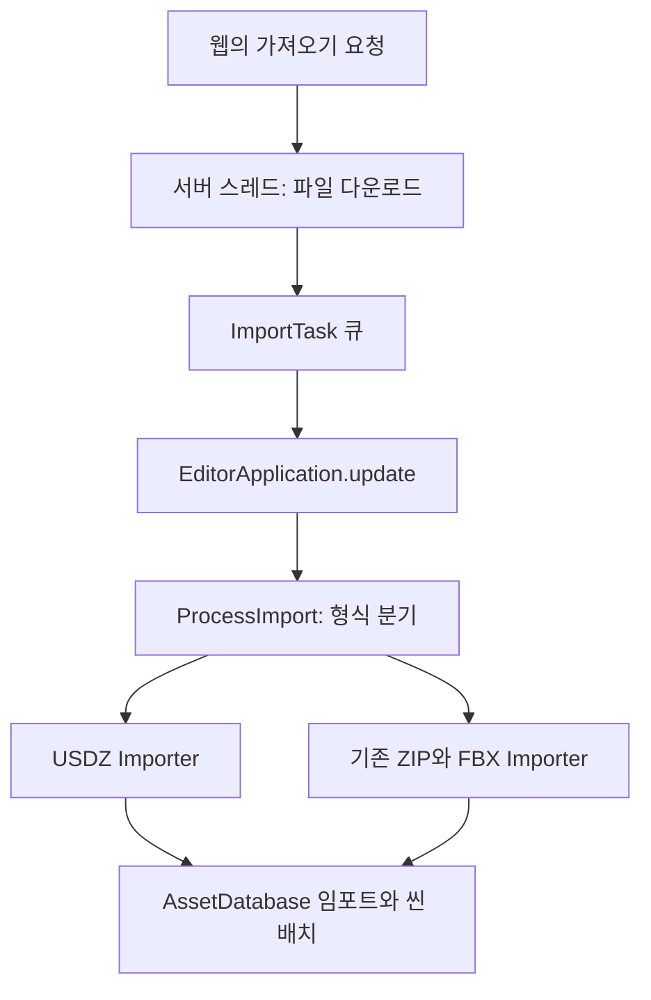

# 변환 알고리즘과 설계

> 모르는 단어는 [전문 용어 전체 색인](../../90_용어사전/README.md)에서 영문·한글로 찾습니다. 이 장 맨 아래에는 등장 용어의 바로가기 목록이 있습니다.

## 알고리즘을 읽기 위한 네 가지 질문

[USD 문서](../../10_모델/03_USD/USD.md)의 파일 구조, [리깅·Avatar·애니메이션 문서](../../60_애니메이션/README.md)의 클립·뼈 경로, [C#과 실행 흐름 문서](../../80_프로그래밍/CSharp와실행흐름.md)의 변수·함수·조건이 선수 개념입니다. **알고리즘**은 입력을 받아 결과를 만드는 정해진 절차입니다. 코드 이름을 외우지 말고 “입력은 무엇인가, 어디서 갈라지는가, 무엇을 쓰는가, 무엇을 확인하는가”를 표시합니다.

**파싱**은 글자를 문법에 따라 의미 있는 값으로 읽는 일입니다. `timeSamples`라는 글자를 찾아 숫자를 뽑는 것과 USD의 모든 참조·레이어 규칙을 해석하는 것은 범위가 다릅니다. **정규식, Regex**는 문자열 패턴을 찾는 규칙이며 범용 USD 해석기 자체가 아닙니다.

**스레드**는 프로그램 일이 진행되는 한 흐름, **큐**는 먼저 들어온 일을 먼저 꺼내는 대기열입니다. 다운로드 담당인 **생산자**가 작업을 넣고 Unity 쪽 **소비자**가 처리합니다. 두 흐름이 동시에 목록을 고치면 꼬일 수 있어 `lock`으로 그 부분에 한 번에 한 흐름만 들어가게 합니다. 프로그램 전체가 한꺼번에 빨라지는 기능은 아닙니다.

**메인 스레드**는 Unity의 주요 씬·에셋 작업을 처리하는 흐름입니다. **도메인 리로드**는 스크립트 실행 환경을 다시 만드는 과정, **세션**은 Editor를 켜서 사용하는 한 실행 기간입니다. 아래 SessionState는 그 기간의 임시 상태를 저장합니다.

## 수식을 읽기 전에 기호를 풀기

`min(a,b)`는 두 수 중 작은 값입니다. 길이 1초 클립의 12%는 0.12초이므로 `min(0.20,0.12)=0.12초`입니다. `t²(3-2t)`에서 t는 보정 구간 진행률입니다. t=0에서 0, t=0.5에서 0.5, t=1에서 1이며 양 끝에서 변화 속도가 작아집니다. 이것이 **Smoothstep** 보간입니다. 부드러운 수치 변화가 발 접지까지 자동으로 보장하지는 않습니다.

**좌표축 변환**은 다른 기준으로 적힌 같은 움직임을 새 기준으로 다시 쓰는 일입니다. USD 쿼터니언 텍스트는 실수부를 앞에 놓는 표현을 사용하고 Unity Quaternion 생성자는 `(x,y,z,w)` 순서입니다. 성분을 올바르게 읽은 뒤 축 변환을 해야 합니다. 아래 `(x,y,z,w) → (-x,-y,z,w)`는 이미 Unity식 성분 이름으로 풀어 적은 이 도구의 가정이며, 원본 USDA의 네 숫자를 그대로 그 순서라고 읽지 않습니다.

이 장은 “버튼 한 번” 안에서 실제로 어떤 데이터가 바뀌는지 읽는 심화 과정입니다. 코드를 외우기보다 **입력·출력·조건·실패 시점**을 찾습니다.

## Bridge의 생산자와 소비자



스레드는 일을 진행하는 흐름입니다. 다운로드 담당이 끝낸 일을 큐에 놓으면 Unity 메인 스레드가 하나씩 처리합니다. `lock`은 큐를 동시에 꺼내고 넣을 때 서로 꼬이지 않도록 지킵니다.

Unity 에셋·씬 변경은 메인 스레드에서 처리해야 합니다. `VARCO3DLifecycle.PumpImportQueue()`는 Editor 업데이트마다 한 건을 꺼냅니다. 백그라운드 스레드가 있으므로 모든 작업이 무조건 안 끊기고 빠른 것은 아닙니다. 실제 임포트는 시간이 걸릴 수 있습니다.

도메인 리로드는 스크립트 실행 환경을 다시 만드는 과정입니다. Bridge는 리로드 전에 서버를 정리하고, SessionState의 연결 의도를 읽어 다시 켭니다. 이 상태는 Unity Editor 세션 범위이며 영구 계정 설정과 다릅니다.

## Run Extract의 분기

```text
선택한 Project 파일이 FBX → ProcessFbx
선택한 Project 파일이 USDZ → 사용할 캐릭터 찾기 → ConvertUsdZ
Hierarchy 물체 선택 → 최상위 루트 찾기 → 이름으로 USDZ 찾기 또는 파일 선택
그 외 → 안내 대화상자
```

코드 읽기 순서: `RunFromCurrentSelection` → `ConvertUsdZ` → `ExtractUsdTextAndTextures` → 클립 처리 → `ConfigureFbxImporter` → `ProcessFbx` → 검증 로그.

## 1. 묶음에서 텍스트와 그림 꺼내기

`ZipArchive`로 USDZ 항목을 읽어 첫 `.usda`를 선택합니다. 이미지 파일명은 폴더를 제거하고 출력 폴더에 저장합니다. 다른 원본 폴더에 동일 파일명이 있으면 충돌할 수 있습니다.

USD는 장면·레이어·참조 등을 표현할 수 있는 큰 규격입니다. 이 도구는 필요한 텍스트 패턴만 읽습니다. Regex와 괄호 짝 찾기는 특정 입력을 처리하기 위한 방법이지 USD 전체 문법 해석기가 아닙니다.

현재 Walk USDZ에는 `model.usda`, Base Color, Normal, ORM PNG 세 장이 있습니다. Y-up, metersPerUnit=1, FPS=30, timeCodesPerSecond=30, startTimeCode=2, endTimeCode=84가 기록되어 있습니다.

## 2. 먼저 Unity가 읽은 클립을 보존한다

Unity가 원본 USDZ에서 만든 AnimationClip을 찾고, Preview 클립을 빼고, 길이가 긴 클립부터 고릅니다. 그 클립을 `_Original.anim`으로 복사합니다.

이유는 좌표축·기준 자세를 Unity Importer가 해석한 결과를 가능하면 유지하기 위해서입니다. 이미 해석된 회전을 텍스트에서 다시 계산하면 서로 다른 기준을 섞을 수 있습니다.

`boundJointCount`는 클립의 Transform 경로와 선택한 계층이 얼마나 맞는지 세는 값입니다. 일부 경로가 맞았다는 사실은 모든 관절이 정상이라는 뜻이 아닙니다.

## 3. 정리 클립을 만든다

`CreateRootHeightCleanClip()`은 원본을 복사한 뒤 추정한 Root 뼈의 Y 위치 곡선만 기준 높이로 고정합니다. Hips·다리 곡선을 전부 삭제하는 방식이 아닙니다.

`BlendLoopBoundary()`는 마지막 `min(0.20초, 클립 길이의 12%)` 구간에서 위치·회전 성분을 첫 값 쪽으로 섞습니다. 시간 비율 `t`에 대해 `t²(3-2t)`를 써 변화의 시작과 끝을 부드럽게 만듭니다.

알아둘 한계:

- Root를 못 찾거나 해당 Y 곡선이 없으면 그 보정은 수행하지 않습니다.
- 끝을 시작에 맞추는 것이 발의 접지나 속도 연속성을 자동 보장하지 않습니다.
- 회전 성분별 보간은 전체 자세의 물리적 의미를 이해한 보정이 아닙니다.
- 점프·계단처럼 수직 이동이 필요한 동작에는 Root Y 고정이 의도한 움직임을 지울 수 있습니다.

즉 Walk 정리용 처리를 모든 클립에 무조건 적용하는 원칙으로 외우지 않습니다.

## 4. 원본 클립이 없을 때의 대체 경로

직접 USDA에서 joints·rotations·translations·scales의 timeSamples를 읽고 Unity AnimationCurve를 만듭니다.

```text
time = (frame - StartFrame) / TimeCodesPerSecond
예: frame=32, StartFrame=2, 초당 30이면 time=1초
```

FPS는 표시·샘플링의 시간 감각, timeCodesPerSecond는 USD 시간 코드의 초 환산 기준입니다. 둘이 항상 같다고 가정하면 안 됩니다. 현재 입력은 둘 다 30입니다.

위 계산에서 2~84의 시간 간격은 약 2.733초입니다. 실제 보존된 Unity 클립 파일의 StopTime은 2.8입니다. 임포터의 클립 범위와 직접 파싱의 시간 원점을 혼동하지 않도록 실제 클립 길이를 따로 확인합니다.

좌표 변환은 VARCO 입력이 Y-up·오른손 좌표라는 전제를 사용합니다.

```text
위치: (x, y, z) → (x, y, -z)
회전 quaternion: (x, y, z, w) → (-x, -y, z, w), 이후 정규화
```

전제가 다른 모든 USD에 쓸 공식이라고 일반화하지 않습니다. 같은 회전은 q와 -q로 표현할 수 있습니다. 연속 프레임의 내적이 음수면 부호를 맞춰 갑자기 먼 회전 경로로 보간되는 문제를 줄입니다.

대체 경로는 `BuildAnimationClip()`으로 바로 클립을 만들며, 원본 복사 경로의 Root 높이 정리·Loop Blend가 자동으로 똑같이 적용되는 구조는 아닙니다.

## 5. FBX 내보내기

캐릭터를 임시 복제하고 기준 자세를 복원합니다. 기존 Animator를 비활성화하고 Legacy Animation을 연결해 FBX Exporter에 넘깁니다. 180도 방향 보정이 감지되면 이를 유지하려는 처리도 있습니다.

`TryFindFbxExporter()`는 Reflection으로 패키지의 `ModelExporter.ExportObject`를 찾습니다. 여기서 Reflection은 거울 반사가 아니라 **실행 중 타입·함수 정보를 찾아 호출하는 C# 기능**입니다.

임시 복제본은 `finally`에서 정리합니다. 원본 씬 물체와 임시 출력 준비 물체를 구분해야 원본을 실수로 내보내기 자세에 고정하지 않습니다.

## 6. Humanoid 판정과 재질 처리

이름 별칭과 후보 점수로 뼈를 매핑합니다. 필수 뼈 15개를 모두 찾으면 Humanoid + Create From This Model을 설정합니다. 부족하면 Generic + No Avatar를 유지하는 경로입니다.

도구의 Retarget Ready는 뼈 구조 발견·애니메이션 발견·필수 매핑 수·Avatar 유효성·Human 여부로 계산합니다. Preview에서 발이 땅을 잘 딛는지는 검사하지 않습니다.

재질은 찾은 텍스처 역할을 연결하고 Renderer의 모든 Material 슬롯을 하나의 재질로 바꾸는 경로가 있습니다. 여러 재질로 나뉜 캐릭터라면 원래의 구분이 사라질 수 있습니다. ORM 채널 재배치는 [PBR·텍스처·재질 문서](../../20_재질과셰이더/01_재질/재질과텍스처.md)에서 다룬 별도 문제입니다.

## 실습: 로그를 판정문으로 바꾸기

새 변환을 실행하기 전 코드만 읽고 다음 표를 채워 봅니다.

| 로그·조건 | 말할 수 있는 것 | 아직 말할 수 없는 것 |
|---|---|---|
| FBX 파일 경로 출력 | 지정 경로를 확인할 근거가 있음 | 모든 메시·클립이 정확함 |
| Bound joints 15 | 15개 경로가 매칭됨 | 전체 뼈가 올바른 축으로 움직임 |
| Avatar Valid=True | Unity Avatar 검사 통과 | 다른 체형의 발 미끄러짐 없음 |
| Retarget Ready=True | 도구의 구조 조건 통과 | 장면 외관·배포 검증 완료 |

**확인 질문:** 기존 클립 보존과 직접 곡선 생성은 왜 다른 경로인가? 함수 이름에 Clean이 있으면 모든 동작에 더 좋은가?

**답:** 이미 해석된 축·경로를 재사용하는 것과 새로 해석하는 것은 오차 조건이 다릅니다. 보정은 특정 문제를 위한 것이며 점프 같은 정상 수직 동작을 손상시킬 수도 있습니다.

## 이 장의 용어 찾기

모르는 말은 아래 링크 또는 [전체 용어 색인](../../90_용어사전/README.md)에서 찾습니다. 영문 UI 이름도 검색할 수 있습니다.

- PC와·Unity: [Editor](../../90_용어사전/01_PC와_Unity.md#editor) · [Export](../../90_용어사전/01_PC와_Unity.md#export) · [Exporter](../../90_용어사전/01_PC와_Unity.md#exporter) · [Hierarchy](../../90_용어사전/01_PC와_Unity.md#hierarchy) · [Import](../../90_용어사전/01_PC와_Unity.md#import) · [Importer](../../90_용어사전/01_PC와_Unity.md#importer) · [Package](../../90_용어사전/01_PC와_Unity.md#package) · [Preview](../../90_용어사전/01_PC와_Unity.md#preview) · [Transform](../../90_용어사전/01_PC와_Unity.md#transform) · [Unity](../../90_용어사전/01_PC와_Unity.md#unity) · [데이터](../../90_용어사전/01_PC와_Unity.md#data) · [프로그램](../../90_용어사전/01_PC와_Unity.md#program)

- 수학과·모델: [Normal](../../90_용어사전/02_수학과_모델.md#normal) · [Normalize](../../90_용어사전/02_수학과_모델.md#normalize) · [Quaternion](../../90_용어사전/02_수학과_모델.md#quaternion) · [Smoothstep](../../90_용어사전/02_수학과_모델.md#smoothstep) · [좌표계 손잡이](../../90_용어사전/02_수학과_모델.md#handedness)

- USD와·파일형식: [.anim](../../90_용어사전/03_USD와_파일형식.md#anim) · [endTimeCode](../../90_용어사전/03_USD와_파일형식.md#endtime) · [FBX](../../90_용어사전/03_USD와_파일형식.md#fbx) · [FBX Exporter](../../90_용어사전/03_USD와_파일형식.md#fbx-exporter) · [joints](../../90_용어사전/03_USD와_파일형식.md#joints) · [metersPerUnit](../../90_용어사전/03_USD와_파일형식.md#meters) · [PNG](../../90_용어사전/03_USD와_파일형식.md#png) · [rotations](../../90_용어사전/03_USD와_파일형식.md#rotations) · [scales](../../90_용어사전/03_USD와_파일형식.md#scales) · [startTimeCode](../../90_용어사전/03_USD와_파일형식.md#starttime) · [timeCodesPerSecond](../../90_용어사전/03_USD와_파일형식.md#timecodespersecond) · [timeSamples](../../90_용어사전/03_USD와_파일형식.md#timesamples) · [translations](../../90_용어사전/03_USD와_파일형식.md#translations) · [upAxis](../../90_용어사전/03_USD와_파일형식.md#upaxis) · [USD](../../90_용어사전/03_USD와_파일형식.md#usd) · [USDA](../../90_용어사전/03_USD와_파일형식.md#usda) · [USDZ](../../90_용어사전/03_USD와_파일형식.md#usdz) · [ZIP](../../90_용어사전/03_USD와_파일형식.md#zip) · [시간 코드](../../90_용어사전/03_USD와_파일형식.md#timecode)

- 표면과·렌더링: [Base Color](../../90_용어사전/04_표면과_렌더링.md#basecolor) · [ORM](../../90_용어사전/04_표면과_렌더링.md#orm) · [Renderer](../../90_용어사전/04_표면과_렌더링.md#renderer) · [Texture](../../90_용어사전/04_표면과_렌더링.md#texture)

- 효과와·움직임과·UI: [Animation](../../90_용어사전/05_효과와_움직임과_UI.md#animation) · [Animation Clip](../../90_용어사전/05_효과와_움직임과_UI.md#clip) · [AnimationCurve](../../90_용어사전/05_효과와_움직임과_UI.md#curve) · [Animator](../../90_용어사전/05_효과와_움직임과_UI.md#animator) · [Avatar](../../90_용어사전/05_효과와_움직임과_UI.md#avatar) · [Generic](../../90_용어사전/05_효과와_움직임과_UI.md#generic) · [Humanoid](../../90_용어사전/05_효과와_움직임과_UI.md#humanoid) · [Legacy Animation](../../90_용어사전/05_효과와_움직임과_UI.md#legacy) · [Loop](../../90_용어사전/05_효과와_움직임과_UI.md#loop)

- 코드와·통신과·검증: [Algorithm](../../90_용어사전/06_코드와_통신과_검증.md#algorithm) · [C#](../../90_용어사전/06_코드와_통신과_검증.md#csharp) · [Domain Reload](../../90_용어사전/06_코드와_통신과_검증.md#domainreload) · [Download](../../90_용어사전/06_코드와_통신과_검증.md#download) · [finally](../../90_용어사전/06_코드와_통신과_검증.md#finally) · [FPS](../../90_용어사전/06_코드와_통신과_검증.md#fps) · [Frame](../../90_용어사전/06_코드와_통신과_검증.md#frame) · [lock](../../90_용어사전/06_코드와_통신과_검증.md#lock) · [Regex](../../90_용어사전/06_코드와_통신과_검증.md#regex) · [SessionState](../../90_용어사전/06_코드와_통신과_검증.md#sessionstate) · [string](../../90_용어사전/06_코드와_통신과_검증.md#string) · [Thread](../../90_용어사전/06_코드와_통신과_검증.md#thread) · [VARCO](../../90_용어사전/06_코드와_통신과_검증.md#varco) · [VARCO Bridge](../../90_용어사전/06_코드와_통신과_검증.md#bridge) · [메인 스레드](../../90_용어사전/06_코드와_통신과_검증.md#main-thread) · [백그라운드](../../90_용어사전/06_코드와_통신과_검증.md#background) · [생산자](../../90_용어사전/06_코드와_통신과_검증.md#producer) · [소비자](../../90_용어사전/06_코드와_통신과_검증.md#consumer)

- 화면의·속성과·메뉴: [Create From This Model](../../90_용어사전/07_화면의_속성과_메뉴.md#create-avatar) · [No Avatar](../../90_용어사전/07_화면의_속성과_메뉴.md#no-avatar) · [StopTime](../../90_용어사전/07_화면의_속성과_메뉴.md#stoptime)

- API와·추가설정: [AssetDatabase](../../90_용어사전/08_API와_추가설정.md#assetdatabase) · [Avatar Valid](../../90_용어사전/08_API와_추가설정.md#avatar-valid) · [BlendLoopBoundary](../../90_용어사전/08_API와_추가설정.md#loopblend) · [Bound joints](../../90_용어사전/08_API와_추가설정.md#bound-joints) · [BuildAnimationClip](../../90_용어사전/08_API와_추가설정.md#buildclip) · [ConfigureFbxImporter](../../90_용어사전/08_API와_추가설정.md#configurefbx) · [ConvertUsdZ](../../90_용어사전/08_API와_추가설정.md#convertusdz) · [CreateRootHeightCleanClip](../../90_용어사전/08_API와_추가설정.md#rootclean) · [EditorApplication](../../90_용어사전/08_API와_추가설정.md#editorapplication) · [EditorApplication.update](../../90_용어사전/08_API와_추가설정.md#editor-update) · [ExtractUsdTextAndTextures](../../90_용어사전/08_API와_추가설정.md#extractusd) · [ImportTask](../../90_용어사전/08_API와_추가설정.md#importtask) · [ModelExporter.ExportObject](../../90_용어사전/08_API와_추가설정.md#exportobject) · [ProcessFbx](../../90_용어사전/08_API와_추가설정.md#processfbx) · [ProcessImport](../../90_용어사전/08_API와_추가설정.md#processimport) · [PumpImportQueue](../../90_용어사전/08_API와_추가설정.md#pumpqueue) · [Retarget Ready](../../90_용어사전/08_API와_추가설정.md#retarget-ready) · [RunFromCurrentSelection](../../90_용어사전/08_API와_추가설정.md#runselection) · [TryFindFbxExporter](../../90_용어사전/08_API와_추가설정.md#findexporter) · [ZipArchive](../../90_용어사전/08_API와_추가설정.md#ziparchive)

- 보충·기초와·도구이름: [Run Extract](../../90_용어사전/09_보충_기초와_도구이름.md#run-extract)

- 프로젝트·코드·식별자: [VARCO3DLifecycle](../../90_용어사전/10_프로젝트_코드_식별자.md#script-varco3dlifecycle)
